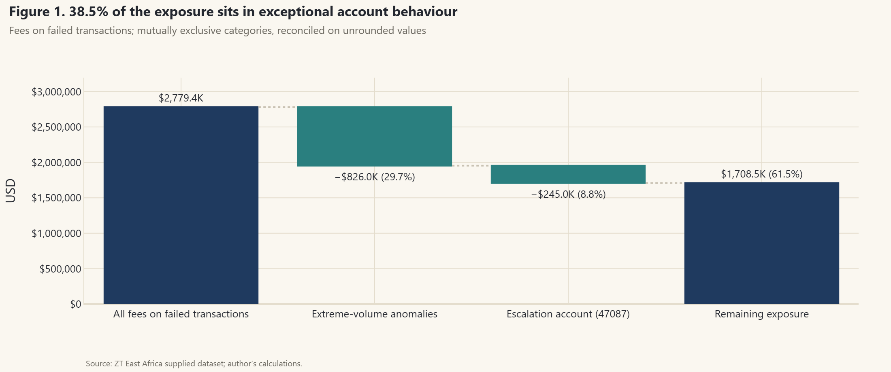
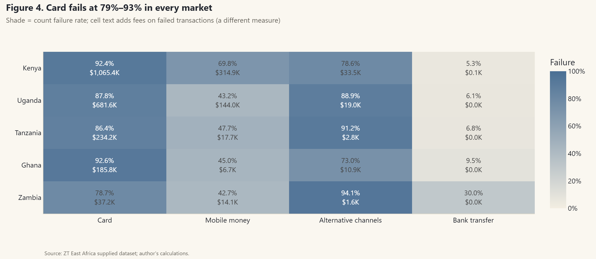
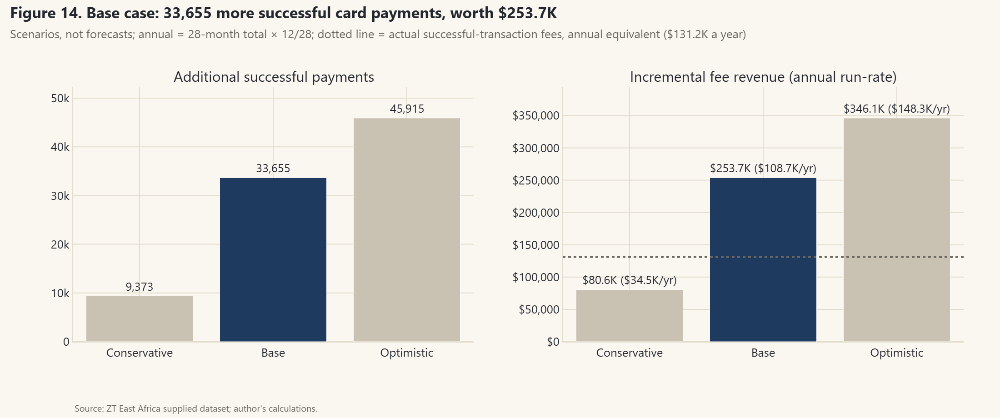
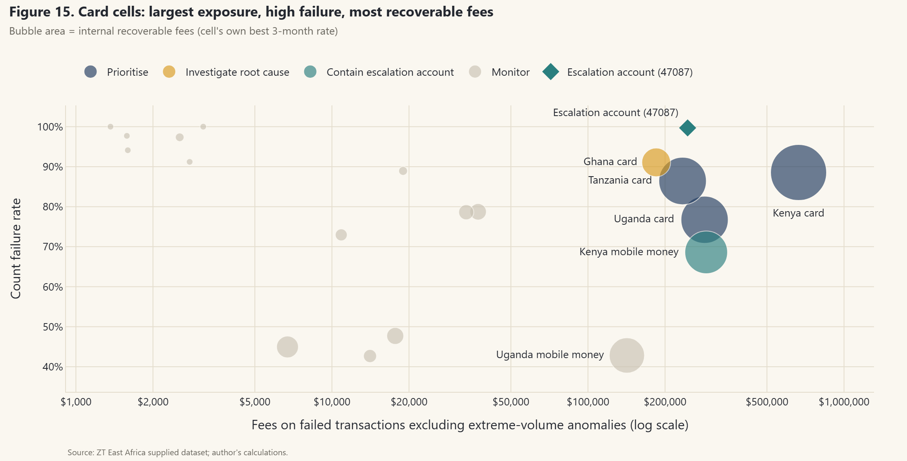

# The Economics of Payment Failure

**Jasco John, CPA (T)** · Zion Tech Hub Finance Data Challenge, 20 November 2026 · Version 1.0.2

Financial exposure, foreign-currency translation and realistic recovery in ZT East Africa transactions, January 2022 – April 2024.

## Start here

| | Who it is for |
| --- | --- |
| **[Full report (PDF)](outputs/report/The_Economics_of_Payment_Failure.pdf)** | Readers who want the whole analysis: findings, method and limitations (35 pages). |
| **[Executive brief (PDF)](outputs/report/Executive_Brief.pdf)** | Decision-makers: the answer and three actions in 5 pages. |
| **[Live dashboard](https://zt-payment-failure-economics.streamlit.app/)** | Anyone who wants to explore: every report figure, recomputed for the period, market, payment type and currency you choose. |
| **[Excel workbook](outputs/payment_failure_analysis.xlsx)** | Finance analysts who want to trace the numbers in formulas. About 50 MB: GitHub downloads it rather than previewing it. |

## The question

Where does payment failure cost ZT East Africa money, how much of it could realistically be recovered, and what should management do first? The study uses 62,684 monthly merchant records (1,645,892 payment attempts) from Kenya, Uganda, Tanzania, Ghana and Zambia, with daily exchange rates and a customer table. It separates exceptional account behaviour from persistent failure, translates every currency with care, and values recovery against an observed benchmark.

## Key findings

1. **Fees on failed transactions total $2.78M, 90.1% of recorded fees, and 62.0% of attempts fail by count.** That headline mixes two problems with different remedies. [Report, Section 2 (p. 8)](outputs/report/The_Economics_of_Payment_Failure.pdf#page=8) · [Dashboard, 2. Scale tab](https://zt-payment-failure-economics.streamlit.app/)
2. **The two anomaly categories account for $1.07M (38.5%).** Twenty extreme-volume observations, including one from account 47087, and that account's continuing escalation, carry it; this is a monitoring problem. [Report, Section 4 (p. 15)](outputs/report/The_Economics_of_Payment_Failure.pdf#page=15) · [Dashboard, 4. Diagnostics tab](https://zt-payment-failure-economics.streamlit.app/)
3. **Remaining exposure is $1.71M (61.5%), and it is steady.** Monthly count failure stays between 48% and 61%; card carries 82% of remaining exposure and USD card alone 61%. [Report, Section 2 (p. 8)](outputs/report/The_Economics_of_Payment_Failure.pdf#page=8) · [Dashboard, 3. Concentration tab](https://zt-payment-failure-economics.streamlit.app/)
4. **USD card completion is the main improvement opportunity.** Excluding extreme-volume anomalies, USD card fails 78–96% by count across the markets against 43–69% for mobile money; even among the 1,332 customers who use both, card fails about 29 percentage points more often. [Report, Section 7 (p. 23)](outputs/report/The_Economics_of_Payment_Failure.pdf#page=23) · [Dashboard, 7. Recovery tab](https://zt-payment-failure-economics.streamlit.app/)
5. **January 2024 was a few accounts, not a breakdown.** Extreme-volume anomalies explain 96% of the month's rise in fees on failed transactions; exchange-rate translation moved it by only $0.4K. [Report, Section 5 (p. 19)](outputs/report/The_Economics_of_Payment_Failure.pdf#page=19) · [Dashboard, 5. January 2024 tab](https://zt-payment-failure-economics.streamlit.app/)
6. **Exchange rates distort the reported trend.** Depreciation cut local-currency fees on failed transactions by $201K (15%) against 2022 rates, and the Ghanaian cedi drives 81% of that effect. [Report, Section 6 (p. 21)](outputs/report/The_Economics_of_Payment_Failure.pdf#page=21) · [Dashboard, 6. Foreign exchange tab](https://zt-payment-failure-economics.streamlit.app/)

## What recovery is worth

If USD card failed no more often than mobile money in each market, the platform would have earned about **$254K** more in successful-transaction fees over 28 months, roughly $109K a year. The conservative and optimistic targets give $81K and $346K. Across benchmark and exclusion choices the base case ranges from $159K to $324K, and resampling customers (5,000 replicates, fixed seed) gives a 90% interval of $142K–$431K. Kenya, Tanzania and Uganda hold $228K of the base case.

It is a conditional estimate, not a forecast:

- it is before processing costs: the break-even is $7.54 of cost per additional successful payment;
- it assumes the gap is actually closed;
- fees on failed transactions are recorded amounts, not cash or earned revenue;
- some failures may be correct rejections: leaving out USD card customer-months with no card success gives $159K;
- the mobile money benchmark is moved by the escalation account (47087): without it the base case is $324K.

[Report, Section 7 (p. 23)](outputs/report/The_Economics_of_Payment_Failure.pdf#page=23)

## Recommendations

- **Contain the two anomaly categories:** two account alerts, one for sudden spikes and one for steady escalation, so that flagged accounts are throttled and reviewed in the same month.
- **Improve USD card completion in Kenya, Tanzania and Uganda,** starting with the merchant-months that had no successful card payment.
- **Report three numbers every month:** the count failure rate, the failed-fee share, and successful-transaction fees at constant 2022 exchange rates.
- **Run a 90-day pilot:** each market's target is its own best three-month USD card failure rate (Kenya 82.9% from 89.0%, Tanzania 70.5% from 85.9%, Uganda 64.9% from 77.6%), with $7.54 per additional successful payment as the cost ceiling. [Report, Section 8 (p. 29)](outputs/report/The_Economics_of_Payment_Failure.pdf#page=29)

## Key visuals



*Figure 1. 38.5% of the exposure sits in exceptional account behaviour. Source: ZT East Africa supplied dataset; author's calculations.*



*Figure 4. Card fails at 79%–93% by count in every market. Source: ZT East Africa supplied dataset; author's calculations.*



*Figure 14. Base case: 33,655 more successful card payments, worth $253.7K. Source: ZT East Africa supplied dataset; author's calculations.*



*Figure 15. Card cells: largest exposure, high failure, most recoverable fees. Source: ZT East Africa supplied dataset; author's calculations.*

## Data and method in brief

- **Data.** The supplied ZT East Africa workbook: 62,684 monthly merchant records (1,645,892 attempts), a customer table and daily exchange rates, January 2022 – April 2024 ([`data/raw/`](data/raw)).
- **Two populations.** Counts use every record; dollar measures use the 62,463 records that have an exchange rate.
- **Translation.** The monthly average of daily rates (an IAS 21-informed approximation), month-end rates as a sensitivity, and each currency's 2022 average rate for constant currency. The Sierra Leone redenomination is corrected.
- **Exposure and recovery.** Every fee on a failed transaction falls into one of three exclusive categories: extreme-volume anomalies, the escalation account (47087) and remaining exposure. Recovery values the USD card gap to mobile money in each market; January 2024 is decomposed with LMDI-I; patterns use Laney control charts.
- **Full method:** [Report, Appendix A (p. 31)](outputs/report/The_Economics_of_Payment_Failure.pdf#page=31).

## Reproducibility

### Reproduce the analysis

Requirements: Python 3.11+ (tested on 3.14, locally and on Streamlit Cloud), plus Chrome or Edge for the static figures and the PDF.

```
git clone https://github.com/JascoJohn/ZT-payment-failure-economics.git
cd ZT-payment-failure-economics
pip install -r requirements-dev.txt
python run_pipeline.py
```

`--from <stage>`, `--only <stage>`, `--skip-excel` and `--recalc-excel` choose what runs; a full run takes about 15 minutes.

Outputs: the report, brief and Word copy are in [`outputs/report/`](outputs/report), the workbook is [`outputs/payment_failure_analysis.xlsx`](outputs/payment_failure_analysis.xlsx), tables and figures are in one folder per chapter under [`outputs/`](outputs), and the audit is [`outputs/audit_report.md`](outputs/audit_report.md).

Changing an assumption: edit [`config/assumptions.yaml`](config/assumptions.yaml) and rerun with `--from 01A`; stage 11 lists every changed value against [`baseline/`](baseline).

Dashboard: `streamlit run app/streamlit_app.py`.

Checks: 131 automated checks, including an independent recomputation in plain pandas; `pytest -q` runs them.

| No. | Script | Report chapter | Excel sheet |
| --- | --- | --- | --- |
| 00 | `00_readme_and_environment.py` | front matter | `00_README` |
| 01A–01G | `01A_assumptions.py` … `01G_transactions.py` (01E runs after 01G) | Appendix A | `01A_…` … `01G_…` |
| 02 | `02_scale.py` | 2 Scale | `02_Scale` |
| 03 | `03_concentration.py` | 3 Where failure concentrates | `03_Concentration` |
| 04 | `04_diagnostics.py` | 4 Failure diagnostics | `04_Diagnostics`, `04_Laney` |
| 05 | `05_january.py` | 5 January 2024 investigation | `05_January` |
| 06 | `06_fx.py` | 6 Foreign exchange analysis | `06_FX` |
| 07 | `07_recovery.py` | 7 Recovery opportunity | `07_Recovery` |
| 08 | `08_recommendations.py` | 8 Management recommendations | `08_Recommendations` |
| 09 | `09_excel_workbook.py` | | |
| 10 | `10_report.py` | | |
| 11 | `11_validate.py` | Appendix B | `99_Checks` |

Details (the report token system, Word export, Excel recalculation and the baseline workflow) are in [`docs/REPRODUCING.md`](docs/REPRODUCING.md).

## Repository contents

- [`app/`](app): the Streamlit dashboard.
- [`baseline/`](baseline): the accepted results that stage 11 compares against.
- [`config/`](config): `assumptions.yaml`, every threshold and rule.
- [`data/raw/`](data/raw): the supplied dataset, unchanged.
- [`docs/`](docs): reproduction details.
- [`outputs/`](outputs): everything the pipeline writes (report, workbook, tables, figures, audit).
- [`report/`](report): the text, style and fonts of the report.
- [`scripts/`](scripts): one script per stage.
- [`src/payfail/`](src/payfail): the analysis package.
- [`tests/`](tests): a pytest wrapper around stage 11.
- [`tools/`](tools): helper scripts.

## How to cite

Jasco John (2026). *The Economics of Payment Failure: Financial exposure, foreign-currency translation and realistic recovery in ZT East Africa transactions, January 2022 – April 2024* (Version 1.0.2). Zion Tech Hub Finance Data Challenge entry. https://github.com/JascoJohn/ZT-payment-failure-economics

## Licence

The code is released under the MIT licence ([`LICENSE`](LICENSE)). The dataset belongs to Zion Tech Hub and is included only to reproduce this entry.

## Contact

Jasco John, CPA (T) · [jasco.john98@gmail.com](mailto:jasco.john98@gmail.com) · ORCID [0009-0007-3630-7943](https://orcid.org/0009-0007-3630-7943)
